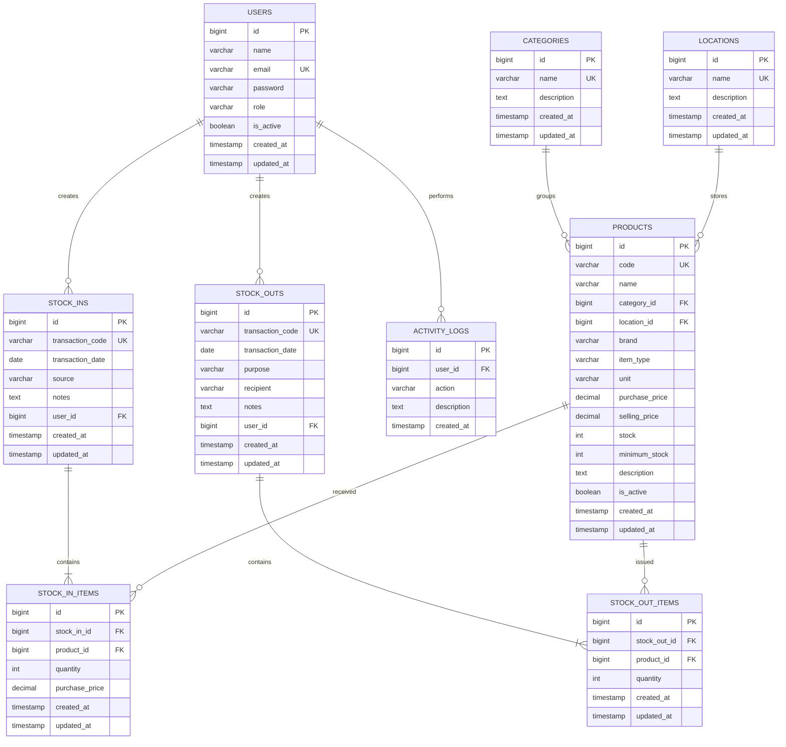

# Entity Relationship Diagram (ERD)

## Diagram

## Penjelasan relasi
- Satu kategori dapat memiliki banyak produk.
- Satu lokasi dapat menjadi lokasi banyak produk.
- Satu pengguna dapat membuat banyak transaksi masuk dan keluar.
- Satu transaksi masuk/keluar memiliki satu atau lebih detail.
- Satu produk dapat muncul pada banyak detail transaksi.
- Satu pengguna dapat menghasilkan banyak catatan aktivitas.

## Catatan
`products.location_id` berarti satu produk hanya mempunyai satu lokasi dalam rancangan MVP. Jika kelak satu SKU perlu berada di beberapa gudang, desain harus diubah menjadi tabel saldo per lokasi, bukan menambahkan kolom lokasi kedua.